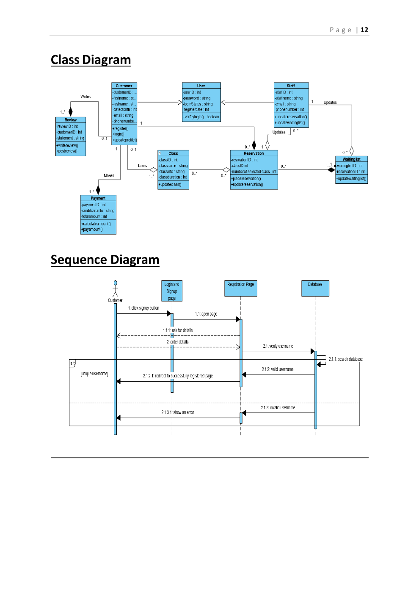

# White Lotus Yoga Booking System Design

Group software-engineering design for a yoga-studio booking system: requirements, reservations, waiting lists, database research, UML and GRASP reasoning.

**Project type:** Group software-analysis and system-design report.

## What the work covers

- Analyses a multi-studio yoga business with course/class bookings, reservations, cancellations, payments and waiting lists.
- Specifies functional and non-functional requirements and considers actors and business processes.
- Documents data-flow, entity-relationship, use-case, class and sequence diagrams.
- Discusses database choices and object-design responsibilities through GRASP patterns.

## Explore the repository

- [Completed group design report](COMP1821-2021-22%20Principles%20of%20Software%20Engineering.pdf)

## Run or read the work

Begin with the White Lotus problem statement and requirements, then use the diagrams to trace how the proposed system represents customers, classes and reservations. The preview reproduces class and sequence diagrams. No executable booking application is committed.

## Scope and limitations

This is an academic system design, not a delivered commercial booking platform. Diagrams and design decisions should be reviewed before implementation, particularly around payment and identity data. The report is collaborative and includes contribution information.

## Academic context

University of Greenwich coursework, COMP1821. The linked specification, where present, is assessment context rather than a completed project deliverable. Reports and source are preserved in their original form.

The preview is taken from the original report; it is not a newly executed result.
